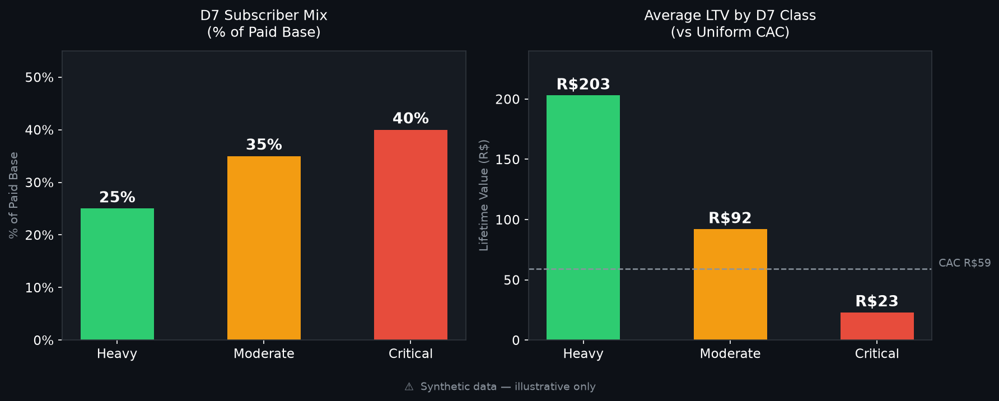
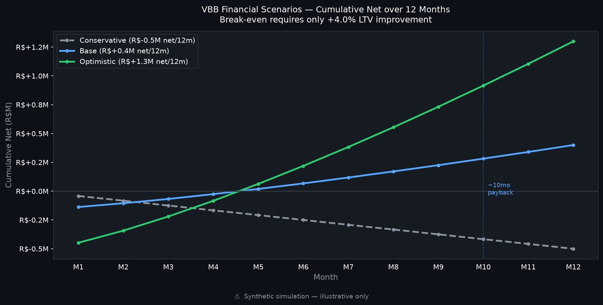

# LTV-Based Media Optimization for Subscription Platforms
## A Decision Science Framework: From Buying Subscribers to Buying Value

> ⚠️ **All data in this repository is fully synthetic**, generated to illustrate methodology. No proprietary or client data is included. Numbers are calibrated against published industry benchmarks for subscription streaming platforms.

[](https://python.org)
[](LICENSE)

---

## The Problem

Most subscription platforms optimize media spend for **cost per acquisition (CPA)** — paying the same amount to acquire every subscriber, regardless of their expected value.

For a streaming platform with 36,000 paid subscribers per month:

| Subscriber Class | % of Paid Base | LTV | CAC | LTV/CAC |
|-----------------|---------------|-----|-----|---------|
| Heavy | 25% | R$203 | R$59 | 3.4x |
| Moderate | 35% | R$92 | R$59 | 1.6x |
| **Critical** | **40%** | **R$23** | **R$59** | **0.4x** |

**R$6.2M per year** is burned acquiring Critical subscribers — users who pay the full CAC and return only 25% of average LTV. The platform is buying subscriptions, not value.

---



## The Framework: D7 Behavioral Classification

Within the first 7 days, subscriber behavior is a strong predictor of long-term value. Three deterministic rules segment every new paid subscriber:

| Class | Rule | LTV | % of Base | Multiplier |
|-------|------|-----|-----------|------------|
| **Heavy** | ≥3 active days AND ≥2 plays in D0–D7 | ~R$203 | 25% | 2.2x |
| **Moderate** | 1 play OR 1–2 active days, no recurring habit | ~R$92 | 35% | 1.0x |
| **Critical** | 0 plays in 7 days OR >4 days without login | ~R$23 | 40% | 0.25x |

*Active day = at least 1 login. Thresholds are calibrated via D7 vs. D60/D90 retention model (target AUC ≥ 0.70). Classification order: Critical first, then Heavy, then Moderate.*

---

## Value-Based Bidding Architecture

The core mechanism: send each subscriber's **predicted LTV (pLTV)** back to the ad platform so the algorithm bids more for users likely to become Heavy subscribers.

```
D0  ── Subscription Purchase ──► Record subscriber_id + plan + channel identifiers (fbp/fbc, gclid)
D0–D7 ── Behavioral Signals ──► Count active days + plays
≤D7 ── Signal Upload ──────────► Meta: pLTV via AppendValue API  |  Google: Offline Conversion + value
        ──► Platform Bid ───────► tROAS or Maximize Conversion Value — more Heavy, less Critical
D14/D30 ── Recalibration ──────► Update LTV signal with observed retention data
```

**Platform requirements:**
- **Meta:** pLTV sent ≤7 days post-conversion; ≥10s of valued conversions per campaign per month
- **Google:** GCLID retained 90 days; upload via Data Manager API; ≥100 conversions/week attributed per campaign

---

## Results: Synthetic Simulation

Shifting the subscriber mix by bidding for value rather than volume:

| Scenario | Heavy | Moderate | Critical | LTV per R$ of Media | Net 12m | Payback |
|----------|-------|----------|----------|---------------------|---------|---------|
| Today (baseline) | 25% | 35% | 40% | — | — | — |
| Conservative | 28% | 36% | 37% | +2.1% | R$-0.5M | >24 months |
| **Base** | **30%** | **37%** | **33%** | **+5.7%** | **R$0.4M** | **~10 months** |
| Optimistic | 33% | 38% | 29% | +9.6% | R$1.3M | ~7 months |

**Break-even requires only +4.0% improvement** in LTV per media R$ — the base scenario exceeds this by 1.7pp.

**Combined with D7 Activation** (targeted engagement for Critical subscribers in the first 7 days):
- R$4.9M net in 12 months
- Payback: ~7 months

---



## Subscription Plan Economics

| Plan | CAC | Avg LTV | LTV/CAC | Expected Life | Key Insight |
|------|-----|---------|---------|--------------|-------------|
| Família | R$70 | R$87 | 1.2x | 2.3 months | Highest CAC, fastest churn — most sensitive to mix shift |
| Premiere | R$50 | R$111 | 2.2x | 4.6 months | Best LTV/CAC — prioritize in budget allocation |
| Telecine | R$30 | R$64 | 2.1x | 5.4 months | Highest retention — lowest volume |

---

## Experiment Design

**Structure:** 50/50 campaign split (value-based bid vs. purchase bid) per plan, run for a minimum of 4 weeks.

| Hypothesis | Test | Success Criterion |
|-----------|------|-------------------|
| D7 signal predicts LTV | D7 model vs. D60/D90 retention | AUC ≥ 0.70 |
| Algorithm shifts mix | A/B: bid-by-value vs. bid-by-purchase | Heavy +5pp; Critical −7pp |
| CPA stays controlled | CAC per plan | CPA ≤ +10% |
| Gain is incremental | Holdout + lift study | Effect sustained at D60 |

**Guardrails:** CPA ≤ +10% | Volume ≥ −7% | Plan mix stable  
**Permanent holdout:** 10% of budget — continuous incrementality measurement  
**Statistical design:** α = 5% bilateral, power = 80%

---

## Repository Structure

| File | Description |
|------|-------------|
| [`notebooks/01_d7_subscriber_classification.ipynb`](notebooks/01_d7_subscriber_classification.ipynb) | D7 behavioral classifier: EDA, RandomForest model, AUC evaluation |
| [`notebooks/02_ltv_modeling_by_plan_and_class.ipynb`](notebooks/02_ltv_modeling_by_plan_and_class.ipynb) | LTV decomposition by plan × D7 class; CAC vs LTV analysis; scenario impact |
| [`notebooks/03_retention_survival_analysis.ipynb`](notebooks/03_retention_survival_analysis.ipynb) | Kaplan-Meier survival curves, hazard rates, expected lifetime per plan |
| [`notebooks/04_experiment_design_ab_vbb.ipynb`](notebooks/04_experiment_design_ab_vbb.ipynb) | Power analysis, sample size, guardrail simulation for A/B test |
| [`notebooks/05_financial_model_vbb.ipynb`](notebooks/05_financial_model_vbb.ipynb) | 3-scenario financial model, payback curve, sensitivity analysis |
| [`notebooks/06_mmm_channel_attribution.ipynb`](notebooks/06_mmm_channel_attribution.ipynb) | Marketing Mix Model: adstock, channel attribution, budget optimization |

**Source modules:**
- [`src/data/synthetic_generator.py`](src/data/synthetic_generator.py) — reproducible synthetic data generation (seed=42)
- [`src/models/d7_classifier.py`](src/models/d7_classifier.py) — rule-based D7 classification + LTV prediction
- [`src/models/ltv_model.py`](src/models/ltv_model.py) — LTV computation by plan and D7 class
- [`src/models/retention_model.py`](src/models/retention_model.py) — survival curves from observed retention data
- [`src/financial/vbb_simulator.py`](src/financial/vbb_simulator.py) — financial scenario simulation

---

## Technical Stack

| Layer | Tools |
|-------|-------|
| Data | Python · Pandas · NumPy |
| Classification | Scikit-learn (RandomForest, AUC) |
| Survival Analysis | Lifelines (Kaplan-Meier, Nelson-Aalen) |
| Experiment Design | SciPy (power analysis, hypothesis testing) |
| Marketing Mix | Statsmodels · custom adstock implementation |
| Visualization | Matplotlib · Seaborn · Plotly |

---

## Getting Started

```bash
git clone https://github.com/brunopamplona/ltv-vbb-growth-science.git
cd ltv-vbb-growth-science
pip install -r requirements.txt
jupyter lab
```

---

## Author

**Bruno Pamplona**  
Lead Decision & Growth Scientist | Causal Inference · LTV/CAC · Experimentation · MMM

[LinkedIn](https://www.linkedin.com/in/brunopamplona) · [GitHub](https://github.com/brunopamplona)
